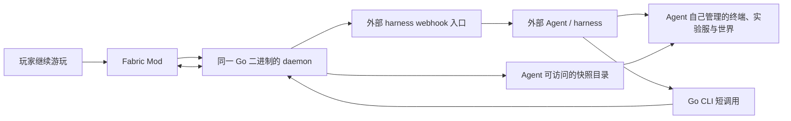

# 架构与模块边界

状态：两组件边界与仓库职责已确认；内部包名、IPC 和具体线格式是首版建议。

## 运行结构

CLI 与 daemon 是同一个发行二进制的不同运行模式。图中的 webhook 入口属于外部 harness；agent-hooks 仓库不引入第三个项目运行服务。多个 daemon 可独立直连同一个 Mod，不经指定 daemon 网关。

## 模块所有权

| 模块 | 所有者 | 输入 / 输出 | 不承担的职责 |
| --- | --- | --- | --- |
| 游戏控制接入 | mod | 认证连接、能力、游戏请求 / 响应与事件 | harness 身份或会话、玩家身体 |
| 玩家上下文 | mod | 玩家 UUID / 名称 / context_id → 权威现场 | 从显示名推断权限、在取回时伪造历史 |
| 游戏操作与协调 | mod | 授权操作 → 执行事实、请求状态 | 实验事务编排、通用任务调度平台 |
| 事件与游戏时钟 | mod | callback / 游戏采样 → 有来源和时点的事件 | 根据轮询猜瞬时因果链 |
| 快照拍摄与封存 | mod | 范围和请求 → manifest、数据、产物状态 | 部署分支世界、恢复配方、实验结论 |
| CLI 与本地 IPC | cli | 终端参数 / JSON → 结构化结果 | 自然语言任务规划或模型 API |
| 目标连接与会话路由 | cli | 目标配置、凭证 → Mod 连接 / 路由 | 游戏进程管理或强制服务器旁 daemon |
| 事件消费与 webhook | cli | Mod 事件 → 游标读取、跟随、接收方协议投递 | Gateway 生命周期、route 创建、模型会话 |
| 快照下载 | cli | 已封存产物 → 校验后的本地目录 | 改写实验数据、世界启动、自动恢复 |
| harness 接入资料与验收 | agent-hooks | profile / fixture / 配置 → 真实互操作证据 | 重复的 Go 投递器、常驻转签服务 |
| 工具 Skill | cli | 工具知识 → harness 可加载说明 | 强制实验配方或模型配置 |

## 建议的代码分层

Go 的逻辑模块建议为 CLI 表达层、本地 IPC、daemon 生命周期、目标配置、控制客户端、请求账本、事件缓存/订阅、webhook delivery、artifact transfer 和版本能力模型。网络适配不得解析研究结论；webhook 不直接调用模型。

Mod 的逻辑模块建议为同端口协议识别与成熟加密层、认证授权、连接会话、游戏线程执行入口、玩家上下文缓存、查询/操作、事件源、写协调、快照 capture/seal/store 和 client-only adapter。模块分层不意味着额外进程。

跨语言共享的是协议和 fixture，不共享游戏内部实现。Go 不复制 Mod 的授权裁决或游戏结果推断；Mod 不认识 Hermes route、harness 安装目录或模型名。

## 部署矩阵

| 游戏环境 | 接入目标 | 所需项目组件 | 必须说明的限制 |
| --- | --- | --- | --- |
| 专用服，有或无在线玩家 | 实际 Minecraft 游戏监听端口 | 服务端 Mod；调用者环境的 Go | 无需客户端 Mod、服务器 daemon、SSH 或第二控制公网端口 |
| 整合服已发布 LAN | 实际发布的 LAN 端口 | 同一 Mod；任意可访问端口的 Go | 不默认 25565；记录世界、gameDir、实例与运行身份 |
| 未发布 LAN 的单机 | 显式本地游戏适配入口 | 同一 Mod；本机 Go | 具体 IPC 方案待定，不以旧 Python/legacy listener 自动承接 |
| 客户端专有能力 | 明确 client vantage | 客户端加载同一 Mod；Go | GUI、聊天发送、世界打开、连接、录制不可伪称 server capability |
| Hermes 无人值守接入 | 用户管理的 Hermes route | Go 原生 webhook；外部 Hermes | 模型、Gateway、会话与回复目标由 harness 管理 |

代理、NAT 穿透和第三方协议分流的兼容性按实测列入矩阵，不作为默认承诺。同端口能力不得破坏普通 Minecraft 玩家协议。

## 三条主要链路

### 玩家提问

Mod 在服务端收到聊天时捕获 sender/context；事件引用 context_id。Go 忠实转发；Agent 取回原现场，并显式发起后续当前状态查询。迟到、过期、广播阶段 fallback 与实时查询必须可区分。

### Watch

Mod 产生事件，Go 有界缓存与分页重放；订阅者用带流身份的游标跟随。队列丢失、游戏重启、daemon 重启和过滤结果分别表示。消费端变慢不能阻塞游戏或其他调用。

### 现场快照

Agent 请求范围 → Mod 在声明时点拍摄并封存 → Go 查询状态并通过控制通道下载 → 校验并公布本地完成目录。随后 Agent 通过自己的终端创建独立实验环境。源服目录不能被当作 Go 主机的同名路径。

## 仓库边界

主仓库维护产品入口和兼容组合；design 维护产品需求与决策；convention 维护开发和交付规则。cli/mod 各自拥有代码、能力声明、模块测试及构建发行。agent-hooks 拥有接收方互操作资料和验收，生产投递实现留在 Go 二进制。

通用跨组件线协议要有唯一源：建议规范及版本 fixture 放 design，代码仓库按固定提交消费；具体存放方式见 [待定问题](decisions.md)。产品主页不成为协议的第二份副本。

## 故障域

游戏、Go daemon、CLI 调用、webhook 接收端和 Agent 实验进程各有独立生命周期。CLI 退出不等于游戏退出；harness 重启不应要求断开 daemon；daemon 重连不等于安全重发写请求；控制断线不等于清理玩家或解冻世界。

只有控制端实际观察到的状态可以作为恢复依据。租约和长拍摄任务是否连接独立，必须由 Mod 声明并可查询。
